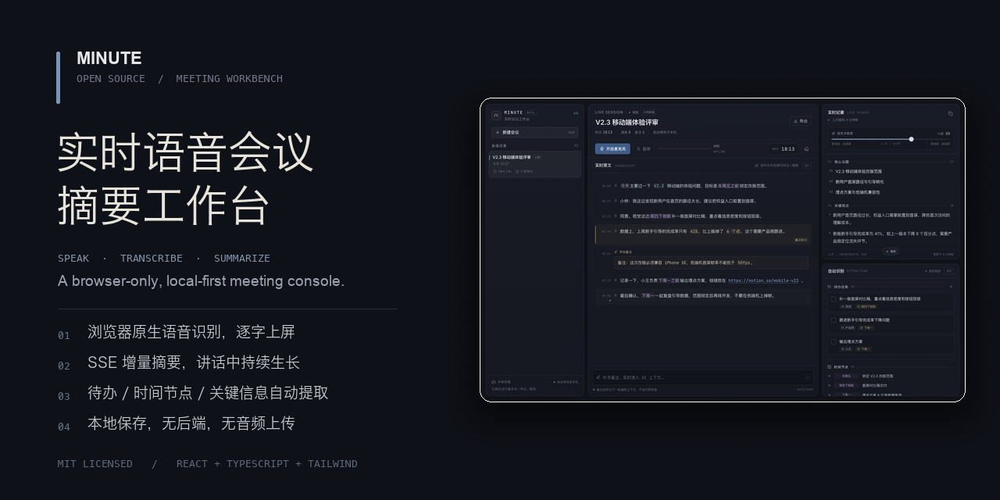
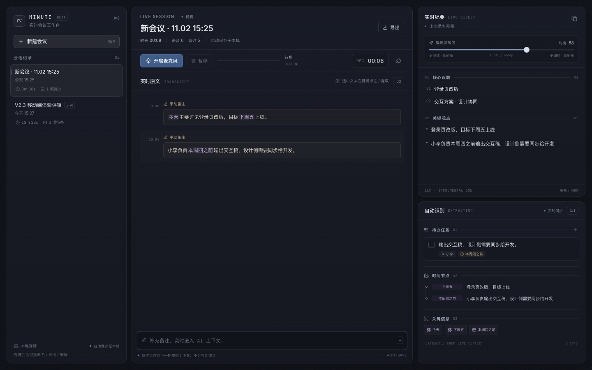

# MINUTE · Real-Time Voice Meeting Workbench

**A browser-only meeting console: speak, transcribe, and grow a structured summary live.**

[中文](README.md) · [Live demo](https://leaduptowin.github.io/vera/) · [Quick start](#quick-start) · [Privacy](PRIVACY.md) · [Contributing](CONTRIBUTING.md)

[](https://github.com/leaduptowin/vera/actions/workflows/ci.yml)
[](https://github.com/leaduptowin/vera/actions/workflows/pages.yml)


> Version `0.1.0`. Mock SSE by default. Replace it with any real SSE endpoint. No backend required.



## Why

Most open-source meeting assistants are heavyweight desktop apps built around Whisper and local models. They are powerful, but installing a client, downloading models, and configuring audio permissions is too much friction for a quick meeting.

MINUTE takes a different route:

- zero-install, runs in the browser;
- native Web Speech API for live transcription;
- no backend, no audio upload;
- meeting state stays in `localStorage`;
- LLM output is streamed over SSE and appended incrementally.

It is not another chat UI. It is a three-column meeting control room:

```text
Sessions / history     Live transcript          Live digest
                     mic · timer              tasks · timeline
                     manual notes             key information
```

## Interaction model

### No submit button

Once the mic is on, the app keeps listening. Every final speech result or manual note enters a debounced summarisation queue. Summary lines, action items, and timeline entries appear incrementally over SSE.

### Sliding window + adaptive throttle

`useStreamSummary` sends only the fresh transcript tail, a recent context window, and the existing full summary. The sensitivity slider changes the debounce immediately:

- high: about `0.5s / ≥14 chars`, finer-grained updates;
- low: about `3.5s / ≥109 chars`, more concise output.



### Manual notes are context

Press Enter in the composer to insert a note. It participates in the next summarisation pass without interrupting recording.

### Selection actions

Select transcript text and right-click to highlight it, extract it into a “key excerpts” section, or delete the selected fragment.

### Structured extraction

- owner + action + deadline;
- dates and milestones;
- links, identifiers, percentages and other key numbers.

Everything is also included in the Markdown export.

## Features

- Web Speech API continuous transcription with auto-restart and graceful fallback
- Permission states: idle, requesting, listening, paused, denied, unsupported, error
- Lightweight canvas waveform
- Live transcript with latest-line emphasis and separate note styling
- Four-section incremental summary: topics, key points, tasks, timeline
- Adjustable sensitivity with live HTTP request throttling
- Task CRUD and completion tracking
- Selection-based highlight, extract, delete
- Meeting CRUD, rename, export, delete
- Markdown export and clipboard copy
- Local-first persistence with `localStorage`
- Responsive tabs below 1280px

## Quick start

Requires Node.js 20+ and pnpm 11+.

```bash
pnpm install
pnpm dev
```

Open the URL printed by Vite, usually `http://127.0.0.1:5173`.

Production:

```bash
pnpm build
pnpm preview
pnpm typecheck
```

> Desktop Chrome or Edge is recommended for Web Speech. Serve over `localhost` or HTTPS.

## GitHub Pages

A Pages workflow is included at `.github/workflows/pages.yml`. Push to `main`, then set **Settings → Pages → Source: GitHub Actions**. The deployed URL is <https://leaduptowin.github.io/vera/>.

Vite uses a relative `base`, so no repository subpath is hard-coded.

See [docs/OPEN_SOURCE_CHECKLIST.md](docs/OPEN_SOURCE_CHECKLIST.md) for the full release checklist.

## Architecture

```text
src/
  App.tsx
  components/      workstation UI, transcript, summary, extraction
  hooks/
    useSpeechRecognition.ts
    useStreamSummary.ts
    useLocalStorage.ts
    useMediaQuery.ts
  lib/
    mock-llm.ts       mock SSE transport + heuristic extraction
    summary-parser.ts markdown contract + line-level merge
    key-info.ts       link/date/identifier/number detection
    export.ts         markdown + clipboard
```

Core properties:

- transcript state is append-only and persisted;
- summary merge is line-level, so streaming does not overwrite checked tasks, edits, or excerpts;
- the hook resets its sliding-window cursor on session switch;
- the app never uploads audio files.

## Real SSE integration

Replace `mockSummarySSE` in [`src/lib/mock-llm.ts`](src/lib/mock-llm.ts) with your stream parser. Keep yielding Markdown deltas.

The expected structure is:

```md
# 会议摘要

## 核心议题
- ...

## 关键观点
- ...

## 待办事项（带责任人、截止时间）
- [ ] owner｜action｜deadline

## 时间节点 & 关键信息
- date｜event
```

`buildSummaryPrompt` already assembles the existing summary, recent context, and fresh transcript. Do not ship shared API keys in the browser bundle.

## Privacy

- Meeting data lives in `localStorage` by default.
- No accounts, analytics, ads, or third-party cookies.
- Mock mode sends nothing to an LLM.
- **Web Speech is not necessarily fully offline.** Chrome and Edge may process audio through vendor speech services.

See [PRIVACY.md](PRIVACY.md).

## Related open-source projects

| Project | Form |
|---|---|
| [Meetily](https://github.com/Zackriya-Solutions/meetily) | Tauri/Rust desktop app with local Whisper/Parakeet |
| [anarlog (formerly Hyprnote)](https://github.com/fastrepl/anarlog) | local-first desktop meeting notes |
| [silverstein/minutes](https://github.com/silverstein/minutes) | local transcription + Markdown + MCP |
| [Bingxi-Jiang/Noted](https://github.com/Bingxi-Jiang/Noted) | full-stack real-time transcription + rolling summaries |
| [shareefmx/minomeet](https://github.com/shareefmx/minomeet) | React + TS meeting MOM, backend/Whisper |

MINUTE’s differentiator is the browser-only, no-backend, no-audio-upload, local-first workflow with manual notes merged into an incrementally streamed summary.

## Contributing

See [CONTRIBUTING.md](CONTRIBUTING.md), [CODE_OF_CONDUCT.md](CODE_OF_CONDUCT.md), and [SECURITY.md](SECURITY.md).

Good first issues: Safari/Firefox compatibility, Chinese sentence-boundary handling, task/date extraction accuracy, mobile long-press selection, real SSE adapters.

## License

[MIT](LICENSE) © 2026 Minute Workbench contributors

Third-party notices: [THIRD_PARTY_NOTICES.md](THIRD_PARTY_NOTICES.md).
