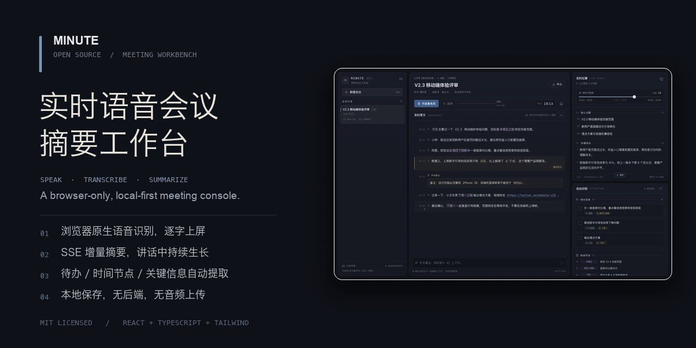
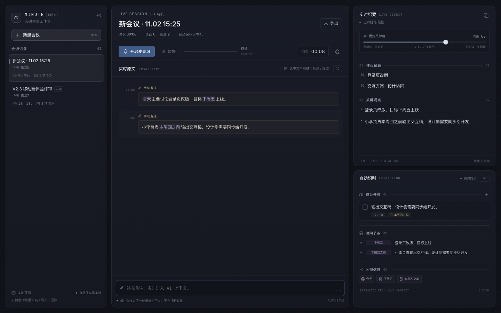

# MINUTE · 实时语音会议摘要工作台

**浏览器里运行的实时会议工作台。边说话，边转写，边生成结构化纪要。**

[English](README.en.md) · [在线 Demo](https://leaduptowin.github.io/vera/) · [快速开始](#快速开始) · [参与贡献](CONTRIBUTING.md) · [隐私说明](PRIVACY.md)

[](https://github.com/leaduptowin/vera/actions/workflows/ci.yml)
[](https://github.com/leaduptowin/vera/actions/workflows/pages.yml)


> 当前版本 `0.1.0`。默认使用本地 Mock SSE，可替换为任意真实 LLM 流式接口。完全前端运行，无后端服务。



## 为什么做这个

大多数开源会议助手是「桌面客户端 + Whisper + 本地模型」的重型方案。它们很强，但想快速记录一场会时，安装、模型下载、权限配置都是门槛。

MINUTE 选择了另一条路：

- 打开网页就能用，不需要安装；
- 使用浏览器原生 Web Speech API 实时转写；
- 无后端、无音频文件上传；
- 会议数据只进入浏览器 `localStorage`；
- LLM 以 SSE 增量流式返回，摘要随讲话持续生长。

它不是另一个聊天框，而是一个三栏会议控制台：

```text
会话 / 历史          实时原文              实时纪要
                  麦克风 · 计时         待办 · 时间节点
                  手动备注              关键信息
```

## 核心交互

### 没有「结束录音」和「生成摘要」

- 开启麦克风后持续收音；
- 识别出完整语句后自动进入提炼队列；
- 摘要、关键观点、待办、时间节点按 SSE 增量出现；
- 不需要点击任何提交按钮。

### 滑动窗口 + 自适应节流

`useStreamSummary` 只切出上次提炼之后的新增转写，携带最近上下文和已有完整摘要组成 Prompt。提炼频率由灵敏度滑块即时控制：

- 高灵敏：约 `0.5s / ≥14字` 触发，粒度更细；
- 低灵敏：约 `3.5s / ≥109字` 触发，摘要更凝练。



### 手动备注也是上下文

中间底部的备注输入不需要提交按钮，按 Enter 即加入当前会议。备注会作为新的增量内容进入下一轮提炼，不会打断收音。

### 选区就是指令

在原文中选中文本后右键：

- **重点高亮**：标记整段内容；
- **单独提取**：加入「重点摘录」；
- **删除片段**：精确删除所选文本。

### 自动提取结构化信息

- 谁 + 做什么 + 截止时间；
- 日期、时间、排期；
- 链接、编号、百分比、帧率等关键数字；
- 全部在实时面板里分类展示，并进入 Markdown 导出。

## 功能

| 模块 | 能力 |
|---|---|
| 语音 | Web Speech 连续中文识别、停顿自动重启、兼容少量英文 |
| 状态 | 待机 / 请求权限 / 收音中 / 已暂停 / 权限拒绝 / 不支持 / 异常 |
| 可视化 | 轻量 Canvas 音量波形，仅收音时绘制 |
| 转写 | 逐字上屏、最新行高亮、语音与备注双样式 |
| 摘要 | 固定四段结构、SSE 分块、新行淡入、复制到剪贴板 |
| 自动识别 | 待办、时间节点、链接、编号、关键数字 |
| 编辑 | 标题编辑、备注、任务新增/编辑/勾选/删除 |
| 会话 | 新建、切换、右键重命名、导出、删除 |
| 导出 | 完整原文 + 摘要 + 待办 + 时间节点 Markdown |
| 存储 | 全部会议状态写入 localStorage，刷新不丢失 |
| 响应式 | 1280px 以下折叠为「会话 / 原文 / 纪要」标签页 |
| 降级 | 浏览器不支持 Web Speech 时保留手动输入 + 实时提炼 |

## 快速开始

需要 Node.js 20+ 与 pnpm 11+。

```bash
pnpm install
pnpm dev
```

打开终端输出的地址，默认 `http://127.0.0.1:5173`。

生产构建：

```bash
pnpm build
pnpm preview
```

类型检查：

```bash
pnpm typecheck
```

> Web Speech API 推荐桌面版 Chrome / Edge，并通过 `localhost` 或 HTTPS 访问。GitHub Pages 默认满足 HTTPS 条件。

## GitHub Pages 在线 Demo

仓库已包含 `.github/workflows/pages.yml`。推送到 `main` 后：

1. 打开 **Settings → Pages**；
2. Source 选择 **GitHub Actions**；
3. 等待 `Deploy to GitHub Pages` 完成；
4. 访问 <https://leaduptowin.github.io/vera/>。

当前仓库地址：<https://github.com/leaduptowin/vera>  
在线 Demo：<https://leaduptowin.github.io/vera/>  

Vite 使用相对 `base`，无需在构建时写死仓库子路径。

完整发布步骤见 [docs/OPEN_SOURCE_CHECKLIST.md](docs/OPEN_SOURCE_CHECKLIST.md)。

## 技术栈

React 18 · TypeScript · Vite 6 · Tailwind CSS 3 · shadcn/ui 风格 Radix Primitives · lucide-react · `@fontsource` Inter / JetBrains Mono。

无后端、无数据库、无音频上传、无第三方语音 SDK。

## 目录结构

```text
src/
  App.tsx                     状态编排、会话 CRUD、计时、导入导出
  components/
    Sidebar.tsx               会话列表、右键菜单、重命名/删除
    ControlBar.tsx            麦克风、暂停、波形、计时、清空
    TranscriptPanel.tsx       实时原文、选区菜单、手动备注
    SummaryPanel.tsx          增量摘要、灵敏度、复制
    ExtractionPanel.tsx       待办、时间节点、关键信息
    TaskDialog.tsx            手动任务表单
    Waveform.tsx              Canvas 波形
    TokenizedText.tsx         链接 / 日期 / 数字着色
    ui/                       shadcn 风格基础组件
  hooks/
    useSpeechRecognition.ts   Web Speech + getUserMedia + 自动重启
    useStreamSummary.ts       防抖切片、SSE 消费、会话边界
    useLocalStorage.ts        防抖持久化
    useMediaQuery.ts          响应式布局
  lib/
    mock-llm.ts               本地 Mock SSE、启发式结构化提炼
    summary-parser.ts         Markdown → 结构化状态 + 行级合并
    key-info.ts               链接 / 日期 / 编号 / 数字识别
    export.ts                 Markdown 导出与剪贴板
    seed.ts                   首次访问的示例会议、空会话工厂
  index.css                   纸感暗调主题、极简动效
```

## 接入真实 LLM

Mock 接口位于 [`src/lib/mock-llm.ts`](src/lib/mock-llm.ts) 的 `mockSummarySSE`。替换为真实 SSE 请求即可，UI 与状态层不需要改动。

```ts
const response = await fetch('/api/summary/stream', {
  method: 'POST',
  headers: { 'Content-Type': 'application/json' },
  body: JSON.stringify({ prompt }),
  signal,
})
const reader = response.body!.getReader()
const decoder = new TextDecoder()
let buffer = ''

while (true) {
  const { done, value } = await reader.read()
  if (done) break
  buffer += decoder.decode(value, { stream: true })
  const events = buffer.split('\n\n')
  buffer = events.pop() ?? ''
  for (const event of events) {
    const data = event.split('\n').find((line) => line.startsWith('data:'))
    if (!data) continue
    const payload = JSON.parse(data.slice(5).trim())
    if (payload.delta) yield payload.delta
  }
}
```

约束：

1. 每次 `yield` Markdown 增量片段；
2. 保持固定四段：核心议题、关键观点、待办事项、时间节点 & 关键信息；
3. 任务行格式：`- [ ] 责任人｜做什么｜截止时间`；
4. `buildSummaryPrompt` 已组装「已有完整摘要 + 最近上下文 + 本次新增转写」。

⚠️ 不要在浏览器源码中硬编码共享 API Key。可以使用用户自填 Key、自己的代理服务或边缘函数。

## 隐私边界

- 会议内容默认只存在浏览器 `localStorage`；
- 无账户、无统计脚本、无广告、无第三方 Cookie；
- 默认 Mock 模式不会把会议内容发送到外部 LLM；
- **Web Speech API 不等于完全离线识别**。Chrome / Edge 可能将音频交给厂商的语音服务处理。

详细说明见 [PRIVACY.md](PRIVACY.md)。如果“语音也完全本地”是硬需求，可以贡献一个基于 Whisper WASM / Transformers.js / WebGPU 的可选识别后端。

## 和已有开源项目的关系

这个方向已经有成熟项目，我们在设计和定位时参考了它们：

| 项目 | 形态 | 与 MINUTE 的差异 |
|---|---|---|
| [Meetily](https://github.com/Zackriya-Solutions/meetily) | Tauri/Rust 桌面端，本地 Whisper/Parakeet | 更重、更强，可采系统音频与说话人分离 |
| [anarlog（原 Hyprnote）](https://github.com/fastrepl/anarlog) | 本地优先桌面会议笔记 | 桌面应用，生态更完整 |
| [silverstein/minutes](https://github.com/silverstein/minutes) | 本地转写 + Markdown + MCP | 桌面端，偏知识管理 |
| [Bingxi-Jiang/Noted](https://github.com/Bingxi-Jiang/Noted) | 全栈实时转写 + rolling summary | 需要 Node + Deepgram + Gemini + SQLite |
| [shareefmx/minomeet](https://github.com/shareefmx/minomeet) | React + TS + Node/Python 会议 MOM | 需要后端与 Whisper |
| [zsjHub/dsh-meeting-notes](https://github.com/zsjHub/dsh-meeting-notes) | DSH 插件 + Web Speech + DeepSeek | 插件形态，不是独立工作站 |

MINUTE 的差异点是：**零安装、纯浏览器、无后端、无音频上传、本地保存、可调刷新节奏的三栏实时工作台。**

## 贡献

欢迎 Issue、PR、设计建议和真实使用反馈。

- [Contributing Guide](CONTRIBUTING.md)
- [Code of Conduct](CODE_OF_CONDUCT.md)
- [Security Policy](SECURITY.md)
- [Issue Templates](.github/ISSUE_TEMPLATE)
- [Open Source Checklist](docs/OPEN_SOURCE_CHECKLIST.md)

适合第一次贡献的方向：

- Safari / Firefox 兼容性；
- Web Speech 中文断句与重复结果处理；
- 更准确的任务/日期抽取；
- 移动端长按选区操作；
- 真实 SSE 适配示例；
- 可选的本地 ASR 方案。

## License

[MIT](LICENSE) © 2026 Minute Workbench contributors

第三方依赖与字体许可见 [THIRD_PARTY_NOTICES.md](THIRD_PARTY_NOTICES.md)。
